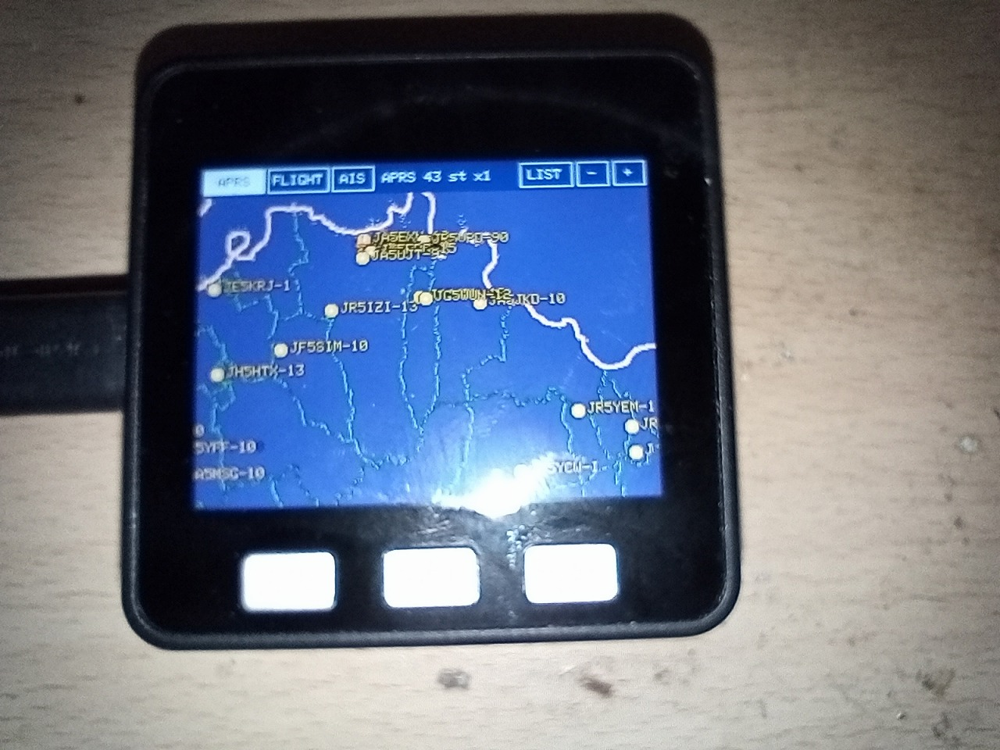

# APRSマップビューア（M5Stack Basic版）

M5Stack Basic（ESP32 / ILI9342C 320×240）で動く、APRS・航空機・船舶のマップ表示機です。
ESP32-2432S028（CYD）版 v78 から移植したもので、タッチ操作を M5Stack の3ボタン操作に置き換えています。

## 画面

| 画面 | 地図 | 内容 |
|---|---|---|
| APRS | 香川県 | APRS-IS から受信した APRS 局（APRS-IS: rotate.aprs2.net） |
| FLIGHT | 岡山県＋香川県 | ADS-B 航空機（adsb.lol、60秒ごとに取得） |
| AIS | 岡山県＋香川県 | AIS 船舶（aisstream.io、APIキーが必要） |

地図はファームウェアに内蔵しているため、SDカードは不要です。

## 特徴

- 初期設定はスマホから（セットアップ用AP「APRSMap-Setup」→ ブラウザのフォーム）。設定は本体の NVS に保存され、`config.h` は初期値（種）です
- 受信した局は電源を切っても保持され、次回起動時に復元されます（最大56局）
- 画面のちらつき対策として、変化のないマーカーの再描画をスキップします

## ボタン操作

短押し = 0.6秒未満、長押し = 0.6秒以上押してから離す（操作は離したときに実行）

### 地図画面

| 操作 | 動作 |
|---|---|
| BtnA 短押し | APRS画面 |
| BtnB 短押し | FLIGHT画面 |
| BtnC 短押し | AIS画面 |
| 表示中のタブをもう一度短押し | その画面の LIST を開く |
| BtnA 長押し | 次の対象（局・航空機・船）を近い順に選択し、中央表示＋1段階ズームイン。最後の次は初期表示に戻る |
| BtnB 長押し | 選択中の対象の詳細（未選択なら LIST を開く） |
| BtnC 長押し | ズームを1段階進める（最大の次は最も広い表示に戻る） |

### LIST表示中

- BtnA 短押し: 次の行 / BtnA 長押し: 前の行（選択行は黄色）
- BtnB 短押し: その行の対象を中央に表示して詳細を開く
- BtnC 短押し: LISTを閉じる

### 詳細表示中

- BtnA 短押し: 次の対象の詳細
- BtnB / BtnC 短押し: 詳細を閉じる

### 設定リセット

電源を入れてスプラッシュが表示された直後に **BtnB を2秒長押し**すると、保存済み設定を消去してセットアップモードで起動します。

## ビルドと書き込み

PlatformIO プロジェクトです。

1. このフォルダを PlatformIO（VS Code）で開く
2. そのまま Upload（通常のアップロードでは本体の設定は保持されます）

依存ライブラリは LovyanGFX のみで、`platformio.ini` の `lib_deps` で自動取得されます。

> **注意:** Web ESPTool などで合体イメージを 0x0 から書くと、設定の保存領域ごと上書きされ、本体の設定（Wi-Fi・コールサイン・AISキー・保存済みの局）が消えます。通常の PlatformIO アップロードでは消えません。

## 設定項目（スマホのフォーム）

Wi-Fi SSID / パスワード、コールサイン、APRS パスコード（0 = 自動計算）、中心の緯度・経度、受信範囲 km、AIS APIキー（aisstream.io の無料キー）。
接続中は http://aprs-map.local からも変更できます。

## 地図データについて

地図データ（`include/maps_data.h`）は、国土地理院の地理院タイルをもとに作成した白地図データ（海岸線・境界）を内蔵用に加工したものです。

