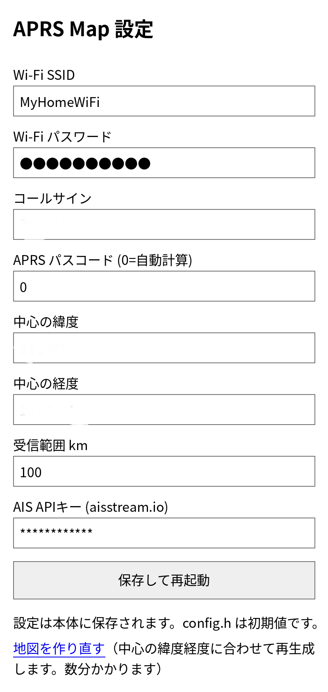

# APRSマップビューア（M5Stack Basic版）

M5Stack Basic（ESP32 / ILI9342C 320×240）で動く、APRS・航空機・船舶のマップ表示機です。
ESP32-2432S028（CYD）版 v78 から移植したもので、タッチ操作を M5Stack の3ボタン操作に置き換えています。

ファームウェア版数: **M5 v8.8**（スプラッシュ表示で確認できます）

## 画面
| 
| 画面 | 地図 | 内容 |
A ボタン　aprs 範囲内のaprs局の表示
B ボタン　frightrader 範囲内の飛行中の航空機を表示
C ボタン　AIS 付近を航行中の船舶（aisstream.io、APIキーが必要） |

地図はファームウェアに内蔵しているため、SDカードは不要です。

## 特徴

- 初期設定はスマホから（セットアップ用AP「APRSMap-Setup」→ ブラウザのフォーム）。設定は本体の NVS に保存され、`config.h` は初期値（種）です
- 受信した局は電源を切っても保持され、次回起動時に復元されます（最大56局）
- 地図は本体でも生成できます。ポータルで中心の緯度・経度を設定すると、次回起動時に地理院タイルを取得してその場所の地図（中心付近の詳細図＋広域図）を本体が作成します（約1.5時間）
- 画面のちらつき対策として、変化のないマーカーの再描画をスキップします

## ボタン操作

短押し = 0.6秒未満、長押し = 0.6秒以上押してから離す（操作は離したときに実行）

### 地図画面

| 操作 | 動作 |
|---|---|
| BtnA 短押し | APRS画面 |
| BtnB 短押し | FLIGHT画面 |
| BtnC 短押し | AIS画面 |

| 表示中のタブをもう一度短押し | その画面の LIST を開く |

| BtnA 長押し | 次の対象（局・航空機・船）を近い順に選択し、中央表示＋1段階ズームイン。最後の次は初期表示に戻る |
| BtnB 長押し | 選択中の対象の詳細（未選択なら LIST を開く） |
| BtnC 長押し | ズームを1段階進める（最大の次は最も広い表示に戻る） |

### LIST表示中

- BtnA 短押し: 次の行 / BtnA 長押し: 前の行（選択行は黄色）
- BtnB 短押し: その行の対象を中央に表示して詳細を開く
- BtnC 短押し: LISTを閉じる

### 詳細表示中

- BtnA 短押し: 次の対象の詳細
- BtnB / BtnC 短押し: 詳細を閉じる

### 設定リセット

電源を入れてスプラッシュが表示された直後に **BtnB を2秒長押し**すると、保存済み設定を消去してセットアップモードで起動します。

## ビルドと書き込み

PlatformIO プロジェクトです。

1. このフォルダを PlatformIO（VS Code）で開く
2. そのまま Upload（通常のアップロードでは本体の設定は保持されます）

依存ライブラリは LovyanGFX のみで、`platformio.ini` の `lib_deps` で自動取得されます。

> **注意:** Web ESPTool などで合体イメージを 0x0 から書くと、設定の保存領域ごと上書きされ、本体の設定（Wi-Fi・コールサイン・AISキー・保存済みの局）が消えます。通常の PlatformIO アップロードでは消えません。

## 設定項目（スマホのフォーム）
最初にwifiにつながらないと設定画面をスマホで表示します。
同じwifiにつながっているスマホからwifiを検索すると、設定のアクセスポイントが表示されますので、そこに接続すれば設定画面が表示されます。
最初白地図を国土地理院からダウンロードして、生成するので90分ぐらい待たされます。一度生成すれば次からはその地図が使われます。

Wi-Fi SSID / パスワード、コールサイン、APRS パスコード（0 = 自動計算）、中心の緯度・経度、受信範囲 km、AIS APIキー（aisstream.io の無料キー）。
接続中は http://aprs-map.local からも変更できます。

## 地図データについて

地図データ（`include/maps_data.h`）は、国土地理院の地理院タイルをもとに作成した白地図データ（海岸線・境界）を内蔵用に加工したものです。

M5 本体のフラッシュメモリの中の、「mapdata」という専用区画に入っています。

場所：フラッシュの 0x400000 から 2MB の区画（ファームウェア本体とは別区画）
中身：先頭に管理情報（中心・範囲・チェックサム）、続いて地図2枚（詳細図と広域図、各 640×480）
ファームウェアは 0x10000 の別区画なので、0x10000 に bin を書いても地図は消えません。
逆に 0x0 にフルイメージを書くと区画ごと初期化されます
なお、生成が済んでいないとき用の予備地図は、ファームウェアに埋め込み（include/maps_data.h）です。

設定画面（Webポータル）
!設定画面
設定はスマートフォンや PC のブラウザから行います。
初回起動時（設定が無いとき）は、本体がアクセスポイントとして起動するので、スマホでその Wi-Fi に接続してから http://192.168.4.1/ を開きます
設定済みの場合は、同じネットワークから http://aprs-map.local/ で開けます（設定画面は通常動作中も開けます）
入力して「保存して再起動」を押すと、本体に保存されて再起動します
項目
説明
Wi-Fi SSID / パスワード
接続する Wi-Fi
コールサイン
APRS-IS へのログインに使用
APRS パスコード
0 のままで自動計算されます
中心の緯度 / 経度
地図の中心（表示・受信の基準）
受信範囲 km
この距離より遠い局・航空機・船舶を表示しません（地図の作り直しには影響しません）

AIS APIキー
aisstream.io の無料キー。AIS（船舶）表示に必要です。

地図の作り直し方法
地図は、本体が国土地理院のタイルから自動生成します（詳細図 z11 ＋ 広域図 z10 の2枚、生成に約90分かかります）。
生成済みの地図がある場合、中心や範囲の設定を変えただけでは作り直しはしません。作り直しは、次のどちらかで指示したときだけ行います。
方法1：本体のボタンで指示する
本体の電源を入れる（またはリセットする）
起動直後のスプラッシュ画面（バージョン表示）が表示されている間に、BtnC を2秒長押しする
「Map remake set!」と表示されれば指示完了。そのまま起動が進み、Wi-Fi 接続後に生成が始まります
方法2：設定画面から指示する
設定画面（Webポータル）を開く
一番下の「地図を作り直す」リンクを押す
本体が再起動し、生成が始まります
生成中の注意
画面に進捗（何枚目か、どこまで進んだか）が表示されます
途中で電源を切ると、最初からやり直しになります。USB 電源に接続したまま、終わるまで放置してください
生成が終わると自動で地図表示に移ります。以後は再起動しても作り直しにはならず、すぐに地図が表示されます
なお、使える地図が1枚も無い場合（初回起動時など）に限り、自動で生成が始まります。

設定画面（Webポータル）
!設定画面
設定はスマートフォンや PC のブラウザから行います。
初回起動時（設定が無いとき）は、本体がアクセスポイントとして起動するので、スマホでその Wi-Fi に接続してから http://192.168.4.1/ を開きます
設定済みの場合は、同じネットワークから http://aprs-map.local/ で開けます（設定画面は通常動作中も開けます）
入力して「保存して再起動」を押すと、本体に保存されて再起動します
項目
説明
Wi-Fi SSID / パスワード
接続する Wi-Fi
コールサイン
APRS-IS へのログインに使用
APRS パスコード
0 のままで自動計算されます
中心の緯度 / 経度
地図の中心（表示・受信の基準）
受信範囲 km
この距離より遠い局・航空機・船舶を表示しません（地図の作り直しには影響しません）
AIS APIキー
aisstream.io の無料キー。AIS（船舶）表示に必要です

地図の作り直し方法
地図は、本体が国土地理院のタイルから自動生成します（詳細図 z11 ＋ 広域図 z10 の2枚、生成に約90分かかります）。
生成済みの地図がある場合、中心や範囲の設定を変えただけでは作り直しはしません。作り直しは、次のどちらかで指示したときだけ行います。
方法1：本体のボタンで指示する
本体の電源を入れる（またはリセットする）
起動直後のスプラッシュ画面（バージョン表示）が表示されている間に、BtnC を2秒長押しする
「Map remake set!」と表示されれば指示完了。そのまま起動が進み、Wi-Fi 接続後に生成が始まります
方法2：設定画面から指示する
設定画面（Webポータル）を開く
一番下の「地図を作り直す」リンクを押す
本体が再起動し、生成が始まります
生成中の注意
画面に進捗（何枚目か、どこまで進んだか）が表示されます
途中で電源を切ると、最初からやり直しになります。USB 電源に接続したまま、終わるまで放置してください
生成が終わると自動で地図表示に移ります。以後は再起動しても作り直しにはならず、すぐに地図が表示されます
なお、使える地図が1枚も無い場合（初回起動時など）に限り、自動で生成が始まります。
